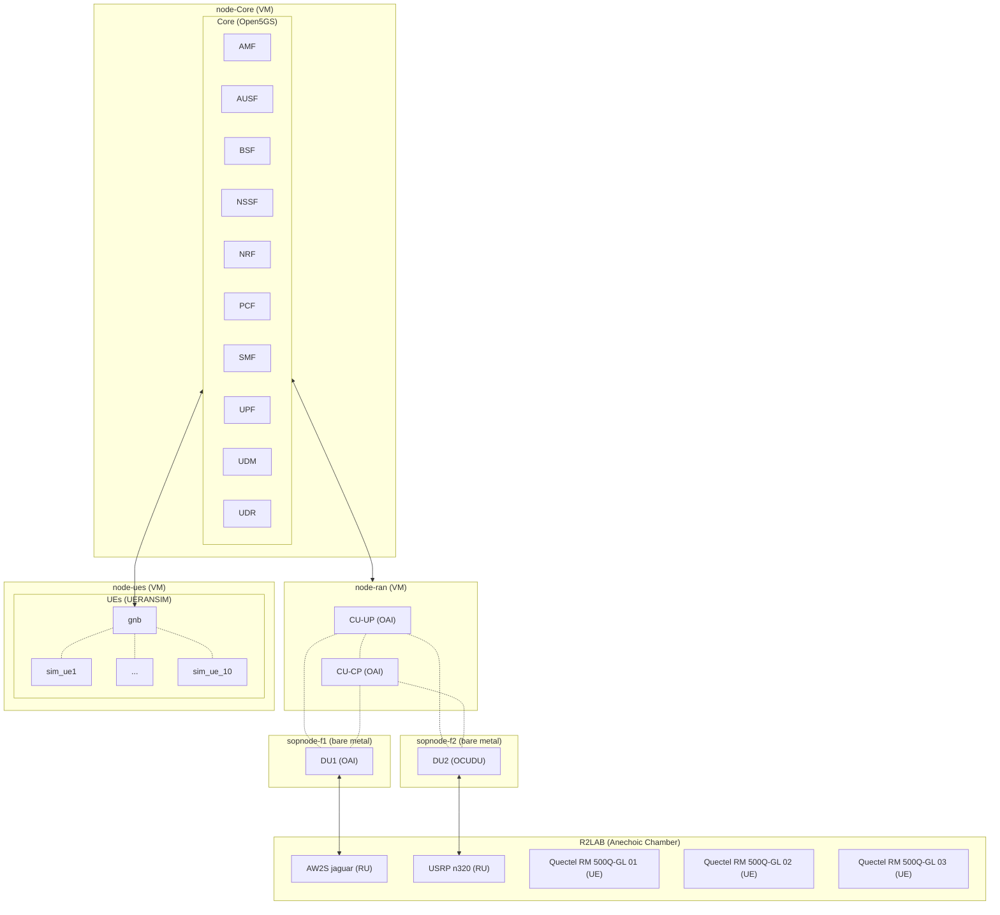
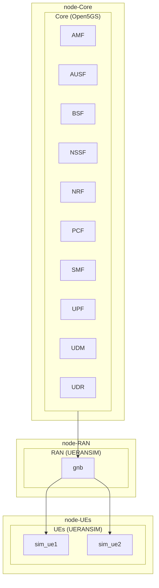

<!-- docs-start -->
# IFRAN: Interoperable Framework for Reproducible Automation of Networks

<p align="center">
  <a href="https://pypi.python.org/pypi/ifran">
    
  </a>
  <a href="https://ifran.readthedocs.io/">
    
  </a>
  <a href="https://github.com/ifran-project/ifran/blob/main/LICENSE">
    
  </a>
  <a href="https://sonarcloud.io/summary/new_code?id=ifran-project_ifran">
    
  </a>
  <a href="https://github.com/ifran-project/ifran/releases">
    
  </a>
  <a href="https://github.com/ifran-project/ifran/pulls">
    
  </a>
</p>

The `ifran` orchestrator is a Python library that deploys and manages a complete 5G network on real or virtual infrastructure, driven by declarative models. With the `ifran` orchestrator you can deploy a new 5G network but also modify it on-the-fly, for example to change a UPF, add a gNB, register new subscribers without interruptions.

You describe **the 5G network you want** and **the machines you want to run it on**. The library then:

1. Provisions the machines (VMs, bare-metal servers, radio units, phones) if needed.
2. Builds a Kubernetes cluster on them.
3. Deploys the 5G core, RAN, RIC and UEs.
4. Lets you fetch logs, run commands on nodes, pods and UEs, add or remove components on the fly, and tear everything down.

It automates the whole stack, including the IP wiring between functions (for example, the gNB's AMF address). Internally it runs [Ansible](https://www.ansible.com/) (through `ansible-runner`) over SSH, and the Kubernetes and Helm operations are executed from the cluster's master node.

The figure below shows an example of complex hybrid deployment made possible by the `ifran` orchestrator.



## Where can it run?

The `ifran` orchestrator is not tied to a specific testbed. There are two ways to use it:

- **On [SLICES-RI](https://doc.slices-ri.eu) infrastructure.** The built-in provisioners (e.g., `bi`, `pos`, `r2lab`) reserve and set up VMs, bare-metal nodes, radio units and phones for you, so a complete network, including real radio equipment, can be deployed from a single description.

- **On any other infrastructure.** Your own servers, a lab cluster, VMs from a public or private cloud, or a local virtualization setup all work, as long as the machines:
  - run **Linux**,
  - are reachable over **SSH**, and
  - can run **Kubernetes** (the 5G functions are deployed on a Kubernetes cluster).

  In that case, declare the machines with `provisioner: null`, mark them `is_provisioned: true` and give their `ssh_info`. The orchestrator then skips provisioning and goes straight to building the Kubernetes cluster and deploying the network. If you already have a Kubernetes cluster, you can also use it directly, as long as its nodes carry the expected role labels.

Both approaches can be mixed in the same deployment, for example a core on your own servers and a RAN with radio units provisioned through [SLICES-RI](https://doc.slices-ri.eu).

## Fundamental concepts

### 1. Metamodel

The [metamodel](https://metamodel-3gpp.readthedocs.io/en/latest/) is the abstract, implementation-agnostic description of the 5G network, based on 3GPP concepts: core, gNBs, UEs (SUPI, S-NSSAI, DNN), RUs, RIC and so on. It comes with full defaults, so you only write what deviates from them. It says **what the network is**, not how it is deployed, so you can reuse it across environments. The orchestrator transparently translates the metamodel into implementation configurations.

### 2. Deployment model

The deployment model is the concrete half. It says **how and where** the network runs:

- which implementation each function uses (Open5GS, OAI, OCUDU, UERANSIM...);
- which machines will be used, which roles they play (`core`, `ran`, `ue`, `ric`) and how to provision them;
- the deployment state: IP addresses, SSH information, Kubernetes cluster details and whether each resource is provisioned.

### 3. Managers

Each lifecycle stage is handled by a manager class. All of them inherit from `BaseManagement`.

| Manager | Main role |
|---------|-----------|
| `ProvisioningManagement` | Provision, unprovision or reserve nodes, RUs and UEs; run commands on nodes; copy files to and from nodes |
| `K8SManagement` | Create or destroy a Kubernetes cluster on the nodes and label them according to their roles |
| `CoreManagement` | Deploy, update or remove core network functions; register or unregister subscribers; run commands in core functions |
| `RANManagement` | Deploy, update or remove RAN functions (e.g., gNB, CU, CU-CP, CU-UP, DU); run commands in RAN functions |
| `RICManagement` | Deploy, update, remove and manage the RIC |
| `UEManagement` | Deploy, connect and disconnect UEs; run commands on UEs |
| `MiscellaneousManagement` | Run custom Ansible playbooks on the nodes, typically to tune machines |

### 4. Kubernetes

Core, RAN, RIC, and potnetially UE functions run on a Kubernetes cluster and are installed with Helm. Kubernetes decides where each function is scheduled using node labels of the form `node-type.5g.blueprint/<role>=true`. For example, core functions only run on nodes labeled `core`, and the same holds for RAN, RIC, UE functions.

- **Virtual UEs and RUs** are deployed inside the cluster.
- **Real RUs** are managed by the orchestrator and connected to the cluster over IP.
- **Real UEs** (phones, modules) connect over their radio link to nearby RUs.

`K8SManagement` can create the cluster for you. You can also use an existing cluster, as long as it meets the requirements and carries the expected labels.

## Design principles

- **Declarative and functional.** Models are deep-copied between managers and input models are never mutated. A manager keeps the model it was built with, so create a new manager after each step.

- **Chaining.** `NextManager(preceding=previous_manager)` inherits the updated models. You can also start from `metamodel` and `deployment_model` objects, or from files.

- **Reconciliation.** When a manager is created, it completes the deployment model with an entry for every component in the metamodel. When needed it derives values from the parameters that are provided.

- **Persistence.** After each stage, you can save the state to human-readable YAML files to resume or share a deployment.

- **Async API.** All actions are `async` so that work can run in parallel.

- **No limitations:** Beside type checking, the orchestrator does not provide any validation to allow experimenters to test any potential setup.

- **Ready for AI:** Managers can be chained to construct arbitrary workflows. A typical deployment chains the managers in order, each one passing its models to the next.

## Supported components

The orchestrator comes with a large collection of supported implementations and support for infrastructures. Users can even define their own images or helm charts in order to be highly customizable.

| Layer | Implementations |
|-------|-----------------|
| Core  | OAI, Open5GS, Free5GC |
| RAN   | OAI, OCUDU, UERANSIM, with support for CU, CU-CP, CU-UP, DU and monolithic gNB (RAN split) |
| RU    | Physical radio units (USRP SDRs, AW2S, Benetel, LiteOn...) |
| RIC   | OAI FlexRIC, O-RAN SC near-RT RIC |
| UEs   | UERANSIM, OAI nr-ue, srsUE (containerized), Quectel 5G modules, COTS phones |

Machines can come from several sources, selected by the `type` of a *provisioner*:

| Provisioner type | Use it for |
|------------------|------------|
| `null` | Machines you already have and can reach over SSH |
| `bi` | SLICES Basic Infrastructure virtual machines |
| `pos`, `legacy_pos` | Bare-metal nodes on POS testbeds |
| `unified_radio`, `r2lab` | Radio units and phones (for example in R2LAB) |

## Minimal example

This example deploys a simple 5G network on virtual machines: one core, one gNB and two virtual UEs.



```python
from ifran import (
    MetaModel
    DeploymentModel
    CoreManagement,
    K8SManagement,
    ProvisioningManagement,
    RANManagement,
    UEManagement,
)

# WHAT: the abstract network (the core uses the defaults)
metamodel = MetaModel.from_yaml(
"""
ran:
  components:
    gnb:
      type: gnb
ues:
  sim_ue1:
    config:
      supi: '001010000000100'
      subscriptions:
      - snssai: internet
        dnn: internet
      gnbs:
      - gnb
  sim_ue2:
    config:
      supi: '001010000000101'
      subscriptions:
      - snssai: internet
        dnn: internet
      gnbs:
      - gnb
"""
)

# HOW and WHERE: implementations, machines and provisioner
deployment_model = DeploymentModel.from_yaml(
"""
ran:
  components:
    gnb:
      type: gnb
      implementation: ueransim
ues:
  sim_ue1:
    implementation: ueransim
    type: containerized
  sim_ue2:
    implementation: ueransim
    type: containerized
nodes:
  node-core:
    provisioner: my-provisioner
    roles:
    - core
    - ric
  node-ran:
    provisioner: my-provisioner
    roles:
    - ran
  node-ues:
    provisioner: my-provisioner
    roles:
    - ue
provisioners:
  my-provisioner:
    type: bi
    params:
      infra: <your_infrastructure>
      project: <your_project>
      experiment: <your_experiment>
      create_experiment: true
      experiment_duration: 2h
      node_duration: 2h
"""
)

# Provision the 3 VMs in SLICES BI
prov = ProvisioningManagement(metamodel=metamodel, deployment_model=deployment_model)
await prov.provision(quiet=False)

# Deploy a Kubernetes cluster on these VMs
k8s = K8SManagement(preceding=prov)
await k8s.deploy(quiet=True)

# Deploy the 5G core functions
core = CoreManagement(preceding=k8s)
await core.deploy(quiet=True)

# Deploy the 5G RAN functions
ran = RANManagement(preceding=core)
await ran.deploy(quiet=True)

# Deploy the UEs
ues = UEManagement(preceding=ran)
await ues.deploy(quiet=True)

# Run a command on the UEs
command = ["ping", "-I", "uesimtun0", "-c", "10", "-D", "8.8.8.8"]
pings = await ues.run_command(command=command, components=["sim_ue1", "sim_ue2"], quiet=True)
print(pings)

# Save the state for reproducibility
ues.metamodel.to_yaml_file("state/metamodel.yaml")
ues.deployment_model.to_yaml_file("state/deployment_model.yaml")
```

If you already have machines, replace the provisioner with `provisioner: null` on each node, set `is_provisioned: true` and give its `ssh_info`.

<!-- docs-end -->

# Tutorials

We provide a vast collection of learn-by-doing tutorials.

## Setup

Information to setup the experimenter's environment.

* [Preparation](./docs/tutorials/00_preparation.ipynb)

## Infrastructure

How to manage the infrastructure where experiments are deployed.

* [Provisioning Resources](./docs/tutorials/01_provision.ipynb)
* [Kubernetes Cluster](./docs/tutorials/02_k8s.ipynb)
* [Cleanup deployments](./docs/tutorials/03_clean.ipynb)

## 5G network deployments and configuration

Main concepts of 5G networking.

* [Simple Scenario](./docs/tutorials/10_simple.ipynb)
* [Add 5G components to a running network](./docs/tutorials/11_add_components.ipynb)
* [TDD Patterns](./docs/tutorials/20_tdd.ipynb)
* [Network Slicing](./docs/tutorials/21_slicing.ipynb)
* [RAN Split](./docs/tutorials/22_split.ipynb)

## Radio Units (RU) and Software Defined Radios (SDR)

Using real Radio Units and User Equipment.

* [OAI with Physical Radio Unit in R2LAB](./docs/tutorials/30_ru.ipynb)
* [OCUDU and OAI with Physical Radio Units in R2LAB](./docs/tutorials/31_ru_full.ipynb)

# Examples

Find a large collection of examples in the [`examples`](../examples) directory.

## Contributing

Contributions are welcome. Please refer to our [Contributing Guidelines](CONTRIBUTING.md) for details.

## License

Distributed under the **BSD 3-Clause Clear** license. See [LICENSE](LICENSE) for details.
